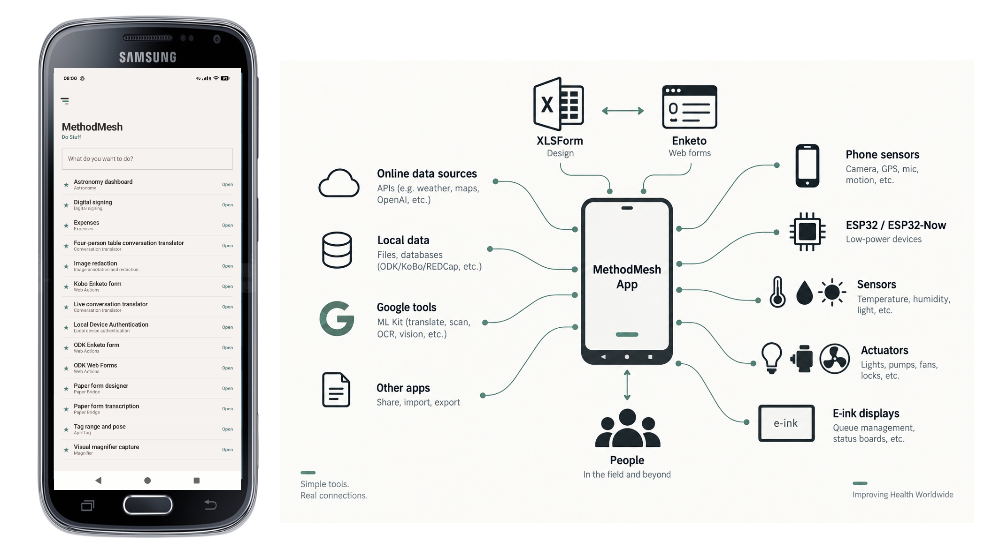

# MethodMesh

MethodMesh is an Android toolkit for people who collect data and make observations in the field, in the lab, and out in the wider world. It brings measurements, evidence, forms, instruments, devices, documents, media and practical methods into one place, with reusable actions that can be run by a person, called from an ODK form, chained into a protocol, or scheduled for headless execution.

It is also a Swiss-army knife for people—and especially nerds—who have accumulated a small app for every small job. Instead of switching between dozens of single-purpose apps, MethodMesh gives those jobs a shared home: one dashboard, one artifact and sharing model, reusable presets, composable protocols, schedules, and a growing set of field-ready capabilities.

> **Work in progress — alpha release.** Interfaces, capability contracts, data formats, and module names are still being refined. This repository is useful for experimentation and development; it is not yet a stable production release.

## What it does

MethodMesh brings common field and everyday tasks into one composable runtime:

- capture measurements, observations, media, documents, locations, text, and sensor readings;
- run small capabilities directly from the dashboard or from another capability;
- save a configured capability as a **preset**;
- combine presets into a **protocol** with ordered steps and output handling;
- run a protocol manually, from ODK, or through a **schedule**;
- run scheduled presets in headless mode, including notifier and log-producing workflows;
- pass artifacts between capabilities without forcing every intermediate file into persistent storage;
- keep persistent files, logs, backups, exports, and module-owned ODK templates in the shared Files/Artifact layer;
- connect to devices and experimental ESP-NOW mesh nodes through the transport and sensor framework.

## Example capabilities

A capability is a specific callable operation, rather than an entire module. For example:

| Task | Capability ID | Useful results (examples, not the complete return contract) |
| --- | --- | --- |
| Scan paper pages and extract text | `document.scan` | PDF attachments, `document_scan_page_count`, `document_scan_ocr_text` |
| Redact sensitive parts of a photo | `image.redact` | Redacted image attachment in `redacted_image_uri`, plus `redacted_image_sha256` |
| Obtain a trusted timestamp for text or a file | `integrity.trusted_timestamp` | Proof attachment, `trusted_timestamp_sha256`, `trusted_timestamp_time_iso`, `trusted_timestamp_trust_status` |
| Select or capture a location as a Plus Code | `plus_code.capture` | `plus_code`, centroid coordinates and acquisition metadata |
| Generate random numbers with a chosen range and count | `random.number.generate` | `random_numbers_csv`, `random_first_number`, algorithm and seed-mode information |
| Spin a wheel of named choices | `chance.spinner.spin` | `spinner_selected_value`, selection index and randomisation metadata |
| Calculate telescope/camera image scale and field of view | `astronomy.image_scale` | `astronomy_scale_arcsec_per_pixel`, horizontal/vertical field of view |

These range from calculations to camera, map and network interactions. Each capability declares its own maturity, connectivity needs and input/output contract. An unattended run is appropriate only when that capability supports it and all necessary inputs and permissions are available. A timestamp proof concerns the exact source bytes; it is not, by itself, proof of authorship or legal validity.

See the [module directories](app/src/main/java/com/example/methodmesh/modules/) for capability documentation and module-owned XLSForms.

## Download

The latest alpha release includes a debug-signed APK for sideloading from the [GitHub Releases page](https://github.com/chrissyhroberts/MethodMesh/releases/latest). It is suitable for testing and field evaluation; review the release notes and install only on devices where you are comfortable enabling an externally downloaded APK.

## How the pieces connect




The important distinction is between an **artifact** and a saved file. A capability can receive a document, produce a signed PDF, and hand it to ODK or another capability without silently creating a permanent copy. A preset may opt into a persistent log when a workflow needs history.

## Presets, protocols, and schedules

### Capabilities

A capability is one useful operation with a stable AS1.00 method contract. It declares its inputs, outputs, settings, and optional Android UI. Capabilities can be launched from the dashboard, invoked through Android intents, or called by another workflow.

### Presets

A preset stores a capability ID and its chosen settings. It is the reusable unit for a common task: for example, “Jeff’s running log”, “sign consent PDF”, or “take an AHT reading”. Presets can be run interactively or configured to save results to a persistent log.

### Protocols

A protocol is an ordered chain of presets. Each step can be configured for transient or saved output, and the protocol closeout can share, copy, export, or pass results onward. Protocols are useful when a task has several deliberate stages.

### Schedules

Schedules are JSON-backed bundles of one or more cron tasks. A task can invoke a notification, preset, protocol, capability, form, or other external action. Each bundle has an explicit initiation point: manual, absolute, event-triggered, or triggered by a preset. Relative tasks can wait for an offset such as “15 days after this preset”, then run a normal cron expression. Retries, follow-ups, multiple aligned tasks, and headless execution are supported. A schedule can run unattended and append results to a preset’s log.

## ODK and external invocation

ODK Collect launches MethodMesh through an Android intent, supplies capability inputs, and receives named results and any file attachments. MethodMesh uses **RIL (Research Intent Language)** to describe the request internally. The convenient `method_id`/`input_*` call and an explicit RIL request use the same execution path.

### Generic capability call

This is a template: replace the angle-bracket placeholders with the capability's declared ID and input keys.

```text
com.example.methodmesh.EXECUTE_METHOD(method_id='<capability_id>',input_<key>='<value>',return_mode='fields')
```

For example, request three numbers between 1 and 6, in steps of 1:

```text
com.example.methodmesh.EXECUTE_METHOD(method_id='random.number.generate',input_count='3',input_min='1',input_max='6',input_step='1',return_mode='fields')
```

The `input_` prefix is transport syntax: `input_count` supplies the capability's `count` setting. Return fields keep their declared names, such as `random_numbers_csv`; they do not acquire an `output_` prefix. Omit optional inputs to use the capability's documented defaults. Some capabilities intentionally open native UI to acquire a missing source, such as a photograph or a file; omission is not universally an error or a request for a default.

### The RIL view of the request

RIL separates the requested operation (**WHAT**), caller/record context (**WHERE**), execution inputs and modifiers (**HOW**), and requested return representation (**RESULT**). A generic single-capability request looks like this; substitute the placeholders and omit context you do not need:

```text
WHAT
execute <capability_id>
WHERE
caller=odk
subject_id=<record_or_subject_id>
HOW
<canonical_input_key>=<value>
RESULT
format fields
```

The random-number example can also be passed explicitly through the `ril` parameter. Semicolons separate lines in this compact binding:

```text
com.example.methodmesh.EXECUTE_METHOD(ril='WHAT; execute random.number.generate; WHERE; caller=odk; HOW; count=3; min=1; max=6; step=1; RESULT; format fields')
```

Inside RIL, use canonical input names such as `count`, without `input_`. Keep an explicit `ril` request self-contained: that parser path takes its inputs and context from the RIL text rather than merging sibling `input_*` parameters. This is a small text binding, not an arbitrary natural-language interpreter; module-owned phrases are optional conveniences, while `execute <capability_id>` is explicit. For punctuation-heavy structured values, prefer the flat call's `input64_<key>` encoding described below. A normal ODK call runs now; parsing a RIL `WHEN` section does not itself create a durable schedule.

### Capture the result in an XLSForm

For several return fields, use a `field-list` group and put the call in its **`body::intent`** column. Child question names match the canonical return keys. For the example above, a minimal `survey` sheet is:

| type | name | label | appearance | body::intent |
| --- | --- | --- | --- | --- |
| begin_group | random_run | Generate three numbers | field-list | `com.example.methodmesh.EXECUTE_METHOD(method_id='random.number.generate',input_count='3',input_min='1',input_max='6',input_step='1',return_mode='fields')` |
| text | methodmesh_status | Execution status | | |
| text | random_status | Generator status | | |
| text | random_numbers_csv | Generated numbers | | |
| text | random_first_number | First number | | |
| text | random_error | Generator error, if any | | |
| text | methodmesh_full_json | Complete execution and audit JSON | | |
| end_group | | | | |

The backticks above are Markdown formatting, not cell contents. This group pattern uses the intent action without `ex:`; that prefix belongs to ODK's single-question external-app appearance. Existing form values can be passed as expressions, for example `input_count=${draw_count}`, where `draw_count` is a question outside this result group. Keep input/control names separate from return question names to avoid collisions with extras sent by Collect. See [ODK's external-app documentation](https://docs.getodk.org/collect-external-apps/#external-apps-to-populate-multiple-fields).

Always capture `methodmesh_full_json` alongside the useful return fields. For a binary result, use a matching `image`, `audio`, `video` or `file` question rather than a text question containing a filename. For example, a `file` question named `document_scan_searchable_pdf_uri` captures that scanner PDF when it is produced. Its historical `_uri` suffix is part of the stable contract; Collect receives the actual attachment through Android content-URI, ClipData and read-grant transport.

Module-owned XLSForms remain in their module folders as the canonical source. The build discovers them and generates an indexed asset catalogue for fast runtime lookup; generated assets are a cache and are never the source of truth.

## How the capability contract works

This section is an integration guide. The [Master Book v1.31](docs/METHODMESH_MASTER_BOOK.md) remains the canonical authority, especially sections 6 (capability contract), 8 (inputs), 10 (ODK) and 11 (outputs).

### One declaration, several entry points

Each independently callable capability has a stable method ID and a versioned implementation. Module-owned method descriptors/contracts declare input references, produced fields and graph outputs; module settings describe configurable values, types, defaults and limits. The capability's documentation and ODK Integration Card describe required/optional inputs, interactive acquisition, modifiers, conditional returns and attachment handling.

The dashboard, presets, protocols, schedules and ODK consume that same declaration. They select and present results for their context; they do not define separate scientific methods or rename canonical fields. An example form demonstrates a selection of outputs rather than limiting what the capability can return. Changing a display label or placing a field in another form group does not change its public contract.

### Request inputs and caller context

| Part of the request | Meaning |
| --- | --- |
| `method_id` | Exact independently callable capability ID, for example `random.number.generate`. |
| `input_<key>` | Capability input or modifier. The transport removes `input_` before passing the value to the capability. Values cross this boundary as text and are interpreted according to the capability's declared type and units. |
| `input64_<key>` | URL-safe Base64 encoding of a UTF-8 input value, useful for static JSON or other punctuation-heavy content. This is encoding, not encryption. Use either encoding for a given key, not both. |
| Caller/record fields | Context such as `caller`, `subject_id`, `study_id`, `site_id`, `form_id`, `form_instance_id` and `operator_id`. These describe the run; supplying an ID does not authenticate a person or establish authorisation. |
| `return_mode` | Representation of the formatted result: `single`, `fields`, `json` or `datapoints`. `fields` is the explicit choice used in the multi-field examples above. |
| `returns` | Optional graph selectors and aliases for advanced projection. These are graph paths, not an arbitrary list of flat output names; use the capability's documented graph outputs. |

An unprefixed output placeholder such as `random_first_number` is not a capability input. For presets, **fixed** values are stored configuration; **runtime** inputs are requested when the preset runs. Operational modifiers, such as precision or a network endpoint, still belong to the declared input contract. Inspect the specific capability's defaults, ranges, units and acquisition modes rather than assuming all modules accept the same options.

### Results, status and the FULL envelope

Internally, a run creates an `ExecutionRequest` and an `ExecutionResult` containing observations, transformations and other applicable knowledge objects, plus validation, quality and diagnostics. The shared output formatter projects those objects into named caller-facing fields and the canonical FULL execution envelope.

| Return layer | What it carries |
| --- | --- |
| Capability fields | The useful result, such as `random_numbers_csv`, plus declared metadata, errors and conditional outputs. Scalar fields, JSON-valued fields and binary attachment fields have different capture requirements. |
| `methodmesh_status` | Shared execution status, for example `Succeeded`, `Failed`, `Cancelled` or `Unsupported`. It is distinct from a capability's own status, such as `random_status`, whose values and meaning are capability-specific. |
| `methodmesh_full_json` | Canonical execution/audit JSON, returned on every handled ODK roundtrip independently of native Share/Save preferences. A transport failure can prevent delivery; Collect may ignore returned extras when an Android activity is cancelled. |

The FULL envelope includes the execution/method identity and result fields, captured application/module/capability versions and maturity, structured `execution_provenance`, `execution_timing`, and policy-neutral `time_assurance` evidence. It records the implementation and evidence associated with that execution. Caller-supplied context remains a claim unless stronger evidence is explicitly bound to it; clock evidence alone does not establish freshness, legal validity or regulatory compliance. A capability-owned field such as `trusted_timestamp_full_json` is separate from the shared `methodmesh_full_json` envelope.

**Return representation and data scope are separate controls.** `return_mode='json'` chooses a representation; it does not by itself define audit scope. `CORE`, `AUDIT` and `FULL` are compatibility tokens for payload projection (`input_payload_mode` in a flat call). ODK still receives the shared FULL sidecar and applicable binary results; a form must declare the fields it wants to retain. Native manual sharing keeps FULL JSON optional, and native saving/export may materialise it as `metadata.json`.

Check both the shared status and the capability's documented success/error fields before using a result. A successful Android return is not itself proof that a measurement or calculation succeeded. Conditional outputs may be absent or empty; do not invent a universal capability-specific success, timestamp or JSON field.

### Files, completion and composition

An internal `artifact://` reference identifies an artifact; it is not an Android attachment URI. At an external boundary, shared transport exposes the bytes through caller-readable `content://` URIs, ClipData and temporary read grants. A filename, path, hash or JSON description alone is not a delivered file. ODK owns submission persistence; temporary transport files do not imply an extra permanent MethodMesh archive copy.

Interactive capabilities acquire a working result and **Commit** finalises it for the caller. Direct execution can return when the declared inputs are sufficient and no operator interaction is required. Cancellation and failure are explicit outcomes, and a missing result should not be treated as a new success. Native share/save actions, protocol closeout and ODK return are different delivery surfaces around the committed result.

Keep canonical examples to one capability call with unprefixed return keys. Advanced user-authored forms can use `methodmesh_return_namespace='photo'` to prefix returned keys, including `photo_methodmesh_full_json`; that changes placement, not the capability's schema. Protocols and other composition surfaces likewise consume declared outputs without changing their meaning.

For implementation details, see the [module interface](app/src/main/java/com/example/methodmesh/modules/MethodMeshModule.kt), [method descriptors and contracts](app/src/main/java/com/example/methodmesh/core/methodmesh/MethodObjects.kt), [execution objects](app/src/main/java/com/example/methodmesh/core/methodmesh/ExecutionObjects.kt), [RIL transport adapter](app/src/main/java/com/example/methodmesh/transport/ril/RilTransportAdapter.kt), and [output formatter](app/src/main/java/com/example/methodmesh/transport/OutputFormatter.kt).

## Current module areas

The repository currently contains modules covering:

- **Field measurement and science:** acoustics, aquatic fieldwork, astronomy, diving, earth science, electrical work, surveying, spatial geometry, visual acuity, calibrated scales, and clinical instruments.
- **Documents and evidence:** reference library, document scanning, digital signing, image annotation/redaction, magnifier, trusted timestamps, text tools, media capture, and Paper Bridge.
- **Forms and data:** ODK form launcher, data tools, field statistics, scoring, sampling, question primitives, conversions/calculator tools, and online API GET.
- **Location, identity, and communication:** compass, Plus Codes, GPS target navigation, QR/barcodes, NFC, SMS, Bluetooth inspection/printing, amateur radio, network tools, and Web Actions.
- **Sensors and hardware:** ESP32 sensor framework, ESP-NOW mesh transport, sensor reading, sensor provisioning and firmware installation, device services, and the workbench.
- **Language, vision, and audio:** ML Kit translation and vision, conversation translation, speech transcription, sound generation, music tools, and media services.
- **Practical and experimental tools:** chance/random number generation, multi-counter, psychomotor vigilance, expenses, emergency tools, aviation, geocaching, GameDeck, Tamagotchi Lab, Signals, Time & Alarms, and the current experimental modules under active development.

Modules are self-contained under `app/src/main/java/com/example/methodmesh/modules/<module>/`. They own their implementation, documentation, settings contributions, and ODK examples. The host discovers modules through the shared module contract rather than hard-coding module-specific UI.

## Repository guide

- `app/src/main/java/com/example/methodmesh/core/` — shared runtime, artifacts, protocols, scheduling, and transport contracts.
- `app/src/main/java/com/example/methodmesh/modules/` — capability modules and module-owned documentation/examples.
- `app/src/main/java/com/example/methodmesh/ui/` — dashboard, Files, ODK catalogue, settings, and shared UI.
- `app/src/main/assets/methodmesh/` — generated runtime indexes and packaged assets.
- `firmware/` — ESP32 firmware and mesh-related development material.
- `docs/METHODMESH_MASTER_BOOK.md` — the canonical architecture and governance reference.

## Building

Open the project in Android Studio or run the standard Gradle build:

```bash
./gradlew :app:assembleDebug
```

The app is developed and tested as an Android application. Some integrations, including ODK Central, KoboToolbox, device transports, and ESP mesh hardware, require their corresponding services or physical devices.

## Documentation

Start with the [MethodMesh Master Book](docs/METHODMESH_MASTER_BOOK.md). Module-specific documentation and XLSForm examples live beside the code that owns them.
